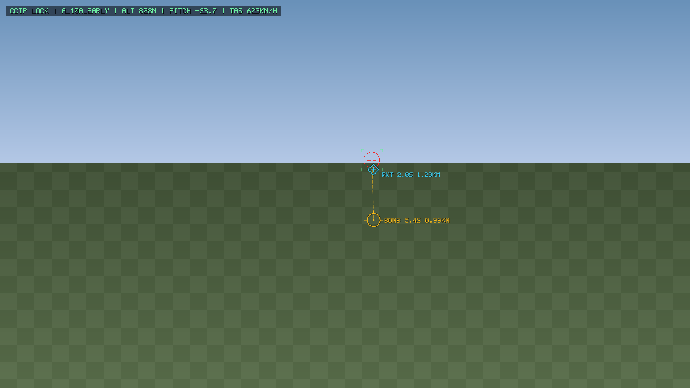
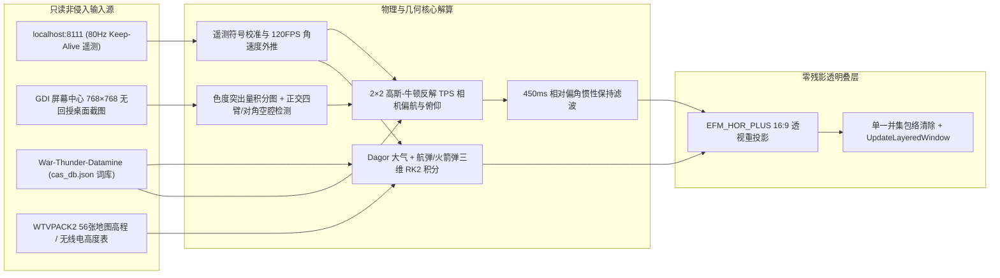

# 战争雷霆第三人称 CAS 航弹与火箭弹 CCIP 物理与视觉反解原型

> [!CAUTION]
> ### 严正合规、使用范围与禁止传播声明（必读）
>
> 1. **严禁用于任何多人在线战局**：本仓库仅作为基于公开引擎源码（`DagorEngine`）、社区拆包数据与官方本地只读网页遥测接口（`localhost:8111`）的**外弹道空气动力学、透视相机几何与抗干扰图形检测算法研究原型**。**严禁在“试飞场 / 试车场（Test Flight / Test Drive）”及纯单人离线自定义任务以外的任何环境（包括但不限于街机 / 历史 / 全真多人匹配战局、联队战、守卫模式、锦标赛等）中使用本程序。**
> 2. **严禁向大众玩家社区传播或分发**：**严禁在非纯粹工程技术研讨环境——包括但不限于 QQ 群、哔哩哔哩（B站）、百度贴吧、小黑盒（Heybox）、NGA、抖音、快手、微信群等游戏玩家社区——宣传、搬运、录屏推广或打包分发本仓库源码、数据库及编译产物。**
> 3. **公平竞技与服务条款风险警示**：在多人在线游戏中使用外部弹道解算或视觉辅助叠层会导致非公平竞技优势，直接违反 **Gaijin Entertainment《最终用户许可协议》（EULA）与《服务条款》（Terms of Use）**，并可能导致账号永久封禁等严重后果。查阅、克隆或编译本仓库即表示您已充分知悉并同意严格遵守上述边界；任何越界使用或违规传播行为均与技术原理探讨无关，一切后果由行为人自行承担。



---

## 项目背景与核心技术难点

在《战争雷霆》（War Thunder）第三人称视角（TPS）下进行固定翼或武装直升机近距空中支援（CAS）俯冲投弹/发射火箭弹时，若完全遵循**零内存读取、零 DLL 注入、零驱动/DMA 介入**的非侵入式硬件与系统红线，计算并绘制连续计算落点（CCIP, Constantly Computed Impact Point）面临三个核心几何与物理耦合难题：

1. **相机自由旋转缺失（鼠标牵引盲区）**：官方本地网页遥测 `http://127.0.0.1:8111` 仅输出**机体本身**的航向、俯仰、横滚与速度参数，**完全不输出玩家鼠标自由牵引下的第三人称摄像机朝向 $(\psi_c, \theta_c)$**。在鼠标瞄准（Mouse Aim）机动中，玩家先甩动鼠标旋转相机，机头再滞后追随，相机光轴与机头纵轴之间常存在 $5^\circ \sim 35^\circ$ 的动态夹角。
2. **第三人称显著视差（Parallax）**：根据拆包相机配置 `config/camera.blkx`，固定翼第三人称相机并非位于飞机质心，而是悬挂在机身后方 $17\text{ m}$、上方 $4\text{ m}$ 处，且光轴斜向下指向机体前方 $500\text{ m}$ 的收敛点。在 $200 \sim 800\text{ m}$ 的常规 CAS 投弹斜距上，机腹挂架与相机眼睛之间的空间基线会产生显著的屏幕视差，不能用无穷远平行光近似。
3. **官方遥测符号反转与拆包阻力参数语义分歧**：`8111` 接口输出的俄式地平仪俯仰/横滚与真实姿态角符号相反，美系机型的 `bank` 字段实为限幅 $\pm 8^\circ$ 的侧滑仪小球；拆包火箭弹文件中的 `dragCx` 实为发射巢挂载寄生阻力，真实飞行阻力则由 `CxK` 控制。

本项目采用 **“机头准星亚像素光学锚定 + `2×2` 高斯-牛顿第三人称相机姿态反解 + 三维大气/变质量弹道 RK2 积分 + 零残影透明穿透图层”** 全链路闭环解决上述问题：



---

## 一、坐标系约定、机体正交基与 `8111` 遥测校准方程

### 1.1 Dagor 左手世界坐标系与小地图反归一化

对齐 `GaijinEntertainment/DagorEngine` 与游戏内陆战/空战地图网格，全局采用**左手三维笛卡尔世界坐标系**：

- **$+X$ 轴**：指向正东（East，单位：$\text{m}$）
- **$+Y$ 轴**：指向天顶（Up，海拔高度 ASL，单位：$\text{m}$）
- **$+Z$ 轴**：指向正北（North，单位：$\text{m}$）

`http://127.0.0.1:8111/map_info.json` 提供地图世界边界 $[x_{\min}, z_{\min}]$ 与 $[x_{\max}, z_{\max}]$，而 `/map_obj.json` 中玩家图标（`icon == "Player"`）输出的归一化坐标 $(x_{\text{norm}}, y_{\text{norm}}) \in [0, 1]^2$ 原点位于地图**左上角（西北角）**，$y_{\text{norm}}$ 自北向南递增。因此水平世界坐标 $(X, Z)$ 的反算关系为：

$$
\begin{aligned}
X(t_0) &= x_{\min} + x_{\text{norm}} \cdot (x_{\max} - x_{\min}) \\
Z(t_0) &= z_{\max} - y_{\text{norm}} \cdot (z_{\max} - z_{\min})
\end{aligned}
$$

由于 `/map_obj.json` 刷新率较低（本程序将其隔离在 `160 ms` 独立后台慢速线程以防阻塞姿态采集），主循环利用高频水平速度分量在两次地图采样之间做航位推算（上限外推 $\Delta t \le 0.35\text{ s}$）：

$$
V_h = \sqrt{\max\!\left(V_{\text{TAS}}^2 - V_y^2,\; 0\right)}, \qquad
\begin{bmatrix} X(t) \\ Z(t) \end{bmatrix} = \begin{bmatrix} X(t_0) \\ Z(t_0) \end{bmatrix} + V_h \Delta t \begin{bmatrix} \sin\psi \\ \cos\psi \end{bmatrix}
$$

### 1.2 机体左手欧拉正交基 $(\mathbf{f}, \mathbf{u}, \mathbf{r})$

设罗盘航向角为 $\psi \in [0^\circ, 360^\circ)$（$0^\circ$ 为正北 $+Z$，$90^\circ$ 为正东 $+X$），真实机头俯仰角为 $\theta$（抬头 $>0$，俯冲 $<0$），真实机体横滚角为 $\phi$（右翼下沉 $>0$，左翼下沉 $<0$）。定义未横滚时的水平右轴 $\mathbf{r}_0$、机头前轴 $\mathbf{f}$ 与零横滚上轴 $\mathbf{u}_0$：

$$
\mathbf{r}_0 = \begin{bmatrix} \cos\psi \\ 0 \\ -\sin\psi \end{bmatrix}, \qquad
\mathbf{f} = \begin{bmatrix} \cos\theta\sin\psi \\ \sin\theta \\ \cos\theta\cos\psi \end{bmatrix}, \qquad
\mathbf{u}_0 = \begin{bmatrix} -\sin\theta\sin\psi \\ \cos\theta \\ -\sin\theta\cos\psi \end{bmatrix}
$$

绕机头前轴 $\mathbf{f}$ 施加右手/左手定义一致的右倾正横滚 $\phi$ 后，机体正交右翼轴 $\mathbf{r}$ 与座舱顶轴 $\mathbf{u}$ 为：

$$
\begin{aligned}
\mathbf{r} &= \mathbf{r}_0 \cos\phi - \mathbf{u}_0 \sin\phi \\
\mathbf{u} &= \mathbf{r}_0 \sin\phi + \mathbf{u}_0 \cos\phi
\end{aligned}
$$

任意拆包机体局部偏移向量 $\mathbf{p}_{\text{local}} = [x_{\text{fwd}}, y_{\text{up}}, z_{\text{right}}]^\top$ 变换至世界坐标系的线性映射即为：

$$
\Delta\mathbf{p}_{\text{world}} = x_{\text{fwd}}\mathbf{f} + y_{\text{up}}\mathbf{u} + z_{\text{right}}\mathbf{r}
$$

### 1.3 官方 `localhost:8111` 遥测三大实机陷阱与修正

直接照搬 `/indicators` 字面字段会导致落点严重偏低或滚转错乱，源码（`src/telemetry.rs`）实施了以下严格物理修正：

#### （1）俄式地平仪刻度反向修正

`/indicators` 中的 `aviahorizon_pitch`（记作 $\theta_{\text{ah}}$）与 `aviahorizon_roll`（记作 $\phi_{\text{ah}}$）表示座舱地平仪球体相对机壳的位移——当飞机以 $-20^\circ$ 俯冲时，`aviahorizon_pitch` 输出 `+20.0`；当飞机向右横滚 $+28^\circ$ 时，`aviahorizon_roll` 输出 `-28.0`。两者必须同时取反：

$$
\theta = -\theta_{\text{ah}}, \qquad \phi = -\phi_{\text{ah}}
$$

对于无虚拟座舱（缺失 `aviahorizon_pitch`）的载具，由航迹倾角 $\gamma$、攻角 $\alpha$ 与横滚角 $\phi$ 精确重构俯仰角：

$$
\gamma = \arcsin\!\left(\operatorname{clamp}\!\left(\frac{V_y}{V_{\text{TAS}}}, -1, 1\right)\right), \qquad \theta = \gamma + \alpha \cos\phi
$$

#### （2）排除美系飞机 `bank` 侧滑球伪装

在 `a_10a_early` 等诸多美系飞机的拆包仪表中，`bank` 对应的是转弯侧滑仪底部限幅 $[-8, +8]$ 的侧滑玻璃球而非横滚坡度。横滚角解析优先级固定为 `-aviahorizon_roll` $\to$ `-aviahorizon_roll1` $\to$ `bank`。

#### （3）英尺/米制无线电高度表自动识别

现代攻击机与直升机在 `/indicators` 中提供 `radio_altitude`（离地真实净高 AGL），但英美机型常按英尺（`altitude_koef = 3.28`）输出。程序实时比对座舱气压高度表读数 $H_{10\text{k}}$（`altitude_10k`）与 `/state` 中的公制海拔 $H_{\text{ASL}}$（`H, m`）：

$$
\text{isFeet} \iff \left|\frac{H_{10\text{k}}}{H_{\text{ASL}}} - 3.28084\right| < 0.45
$$

自动折算为公制离地净高 $h_{\text{rad}}$ 后（剔除 $\ge 1420\text{ m}$ 的满量程钉死值），直接反推出飞机正下方实时地面海拔 $h_{\text{ground}} = H_{\text{ASL}} - h_{\text{rad}}$。

### 1.4 飞机三维初速矢量合成与 `120 FPS` 姿态外推

飞机机头指向 $\mathbf{f}$ 并不等于气流运动方向。设 `/state` 给出的迎角（攻角）为 $\alpha$（`AoA, deg`，$\alpha > 0$ 时机头高于速度矢量，气流相对运动沿 $-\mathbf{u}$ 偏转）、侧滑角为 $\beta$（`AoS, deg`），真空速为 $V_{\text{TAS}}$：

$$
\hat{\mathbf{v}}_{\text{aero}} = \operatorname{normalize}\!\big(\cos\alpha\cos\beta\,\mathbf{f} - \sin\alpha\cos\beta\,\mathbf{u} + \sin\beta\,\mathbf{r}\big), \qquad \mathbf{v}_0 = V_{\text{TAS}}\,\hat{\mathbf{v}}_{\text{aero}}
$$

当 `/state` 提供精确垂直升降率 $V_y$（`Vy, m/s`）且 $|V_y| \le 0.995\,V_{\text{TAS}}$ 时，保持总真空速模长 $\|\mathbf{v}_0\| = V_{\text{TAS}}$ 守恒，将水平分量按比例重标定：

$$
\eta_h = \frac{\sqrt{V_{\text{TAS}}^2 - V_y^2}}{\sqrt{v_{0,x}^2 + v_{0,z}^2}}, \qquad \mathbf{v}_{\text{ac}} = \begin{bmatrix} \eta_h v_{0,x} \\ V_y \\ \eta_h v_{0,z} \end{bmatrix}
$$

此外，针对网页遥测内部约 `15 Hz` 刷新率及整米高度截断（`H, m` 四舍五入至整米，高速俯冲时每 `66 ms` 会产生 $5 \sim 8\text{ m}$ 的阶梯跳变）带来的画面微顿挫，后台采集线程实施了**多速率 $\alpha$-$\beta$ 连续运动学追踪**：

1. **真实姿态 Tick 时间戳分离（消除缓存帧锯齿回弹）**：高频 `8 ms` Keep-Alive 轮询若读到 `8111` 尚未刷新的缓存旧帧，保持上一次真实数值变更时刻 $t_{\text{tick}}$ 不变，渲染帧严格按 $\Delta t_{\text{att}} = t_{\text{render}} - t_{\text{tick}}$ 连续线性外推 $(\psi, \theta, \phi, V_{\text{TAS}})$；
2. **整米高度与连续升降率融合**：未产出新高度跳变时纯靠精确垂直升降率 $\hat{H}(t) = \hat{H}_0 + V_y \Delta t$ 推进；仅在整米读数发生实质跳变时以增益 $\alpha = 0.55$ 融合新息，将海拔阶梯抖动从 $>5\text{ m}$ 压制到 $<0.6\text{ m}$。

---

## 二、DagorEngine 标准大气与外弹道微分方程

### 2.1 Dagor 四阶多项式标准大气模型

严格对齐开源引擎源码 `GaijinEntertainment/DagorEngine/prog/gameLibs/gamePhys/props/atmosphere.cpp`，设海平面基准密度 $\rho_0 = 1.225\text{ kg/m}^3$（对应 $P_0 = 760\text{ mmHg} = 101300\text{ Pa}$，$T_0 = 15^\circ\text{C} = 288.16\text{ K}$），有效多项式截断高度 $H_{\max} = 18300\text{ m}$。令 $h_c = \operatorname{clamp}(h, -500, 18300)$，平流层上界衰减因子 $\sigma(h) = \min(1,\; H_{\max}/h)$，定义四阶霍纳多项式 $P_4(\mathbf{c}, h_c) = \sum_{k=0}^{4} c_k h_c^k$：

$$
\begin{aligned}
\rho(h) &= \rho_0 \cdot P_4(\mathbf{c}_\rho, h_c) \cdot \sigma(h) \\
T(h) &= T_0 \cdot P_4(\mathbf{c}_T, h_c) \\
P(h) &= P_0 \cdot P_4(\mathbf{c}_P, h_c) \cdot \sigma(h) \\
a(h) &= 20.1 \sqrt{\max(T(h), 50.0)}
\end{aligned}
$$

其中引擎硬编码四阶多项式系数表为：

| 物理量 | $c_0$ | $c_1$ | $c_2$ | $c_3$ | $c_4$ |
| :--- | :---: | :---: | :---: | :---: | :---: |
| **空气密度 $\mathbf{c}_\rho$** | $1.0$ | $-9.59387 \times 10^{-5}$ | $3.53118 \times 10^{-9}$ | $-5.83556 \times 10^{-14}$ | $2.28719 \times 10^{-19}$ |
| **大气压强 $\mathbf{c}_P$** | $1.0$ | $-1.18441 \times 10^{-4}$ | $5.67630 \times 10^{-9}$ | $-1.37380 \times 10^{-13}$ | $1.60373 \times 10^{-18}$ |
| **绝对温度 $\mathbf{c}_T$** | $1.0$ | $-2.27712 \times 10^{-5}$ | $2.18069 \times 10^{-10}$ | $-5.71104 \times 10^{-14}$ | $3.97306 \times 10^{-18}$ |

指示空速（IAS）与真空速（TAS）的精确换算关系为 $V_{\text{TAS}} = V_{\text{IAS}} \sqrt{\rho_0 / \rho(h)}$。

### 2.2 自由落体航弹与高阻减速弹（Retarded Bomb）动力学

设航弹质量为 $m$，弹舱开门延迟为 $\Delta t_{\text{bay}}$（外挂架为 $0\text{ s}$，内埋弹舱典型为 $0.40\text{ s}$），挂架向下弹射分离速度为 $v_{\text{ej}} = 1.5\text{ m/s}$。投放瞬间初始状态为：

$$
\mathbf{p}(0) = \mathbf{p}_{\text{ac}} - 0.8\mathbf{u} + \mathbf{v}_{\text{ac}}\Delta t_{\text{bay}}, \qquad \mathbf{v}(0) = \mathbf{v}_{\text{ac}} - v_{\text{ej}}\mathbf{u}
$$

在 `War-Thunder-Datamine` 的 `bombguns/*.blkx` 中，航弹基础有效阻力面积参数由 `dragCx` 与修正乘子 `CxK` 共同决定；对于配备尾翼减速板或阻力伞的高阻弹（如美制 `Mk 82 Snakeye` 的 `brakeTime = [0.3, 0.5]`、`brakeCxK = 110.0`），投出后在 $[t_0, t_1]$ 区间内线性展开减速机构。时刻 $t$ 的瞬时有效阻力面积 $C_d S(t)$ 为：

$$
\beta_{\text{brake}}(t) = \begin{cases}
1, & t \le t_0 \text{ 或无减速机构} \\[4pt]
1 + (\text{brakeCxK} - 1)\,\operatorname{clamp}\!\left(\dfrac{t - t_0}{t_1 - t_0},\; 0,\; 1\right), & t > t_0
\end{cases}
$$

$$
C_d S(t) = \text{dragCx} \cdot \text{CxK} \cdot \kappa_{\text{scale}} \cdot \beta_{\text{brake}}(t)
$$

航弹在高度 $y$ 处的瞬时三维加速度微分方程（重力加速度 $g = 9.81\text{ m/s}^2$）：

$$
\mathbf{a}_{\text{bomb}}(\mathbf{p}, \mathbf{v}, t) = \begin{bmatrix} 0 \\ -g \\ 0 \end{bmatrix} - \frac{\rho(p_y)\, C_d S(t)\, \|\mathbf{v}\|}{2m}\,\mathbf{v}
$$

采用步长 $\Delta t = 0.005\text{ s}$ 的**二阶龙格-库塔法（Heun 预测-校正格式）**推进状态：

$$
\begin{aligned}
\mathbf{a}_1 &= \mathbf{a}(\mathbf{p}_n, \mathbf{v}_n, t_n) \\
\tilde{\mathbf{p}} &= \mathbf{p}_n + \mathbf{v}_n \Delta t, \qquad \tilde{\mathbf{v}} = \mathbf{v}_n + \mathbf{a}_1 \Delta t \\
\mathbf{a}_2 &= \mathbf{a}(\tilde{\mathbf{p}}, \tilde{\mathbf{v}}, t_n + \Delta t) \\
\mathbf{p}_{n+1} &= \mathbf{p}_n + \frac{\Delta t}{2}(\mathbf{v}_n + \tilde{\mathbf{v}}), \qquad \mathbf{v}_{n+1} = \mathbf{v}_n + \frac{\Delta t}{2}(\mathbf{a}_1 + \mathbf{a}_2)
\end{aligned}
$$

### 2.3 空射无制导火箭弹跨音速马赫阻力、导轨离轨、烧蚀减重与自毁门控

> [!IMPORTANT]
> **拆包参数防坑说明**：在 `rocketGuns/*.blkx` 中，顶层字段 `dragCx`（例如蜂巢发射巢内的 `0.00001`）仅代表挂架/吊舱对载机的寄生气动阻力，**绝不能用作火箭弹离巢后的飞行阻力系数**；真实弹体气动阻力系数等于乘子 `CxK`（如 `Hydra-70` 为 $1.65$，`S-24` 为 $0.90$）乘以 **Dagor 尾翼火箭跨音速马赫阻力极曲线 $C_{d0}(M)$**！

记当地马赫数 $M = \|\mathbf{v}\| / a(p_y)$，引擎标准尾翼火箭零升马赫阻力极曲线 $C_{d0}(M)$ 为（经静态关机极速测试核验：`S-24` 与 `Hydra-70` 积分关机极速与拆包资料卡 `maxSpeed` $410\text{ m/s}$、$739\text{ m/s}$ 相对误差 $< 2\%$）：

$$
C_{d0}(M) = \begin{cases}
0.29, & M \le 0.8 \\[4pt]
0.29 + 0.39\,u^2(3 - 2u), \quad u = \dfrac{M - 0.8}{0.3}, & 0.8 < M \le 1.1 \\[8pt]
0.26 + \dfrac{0.42}{1 + 0.55(M - 1.1)}, & M > 1.1
\end{cases}
$$

设发射管相对机体纵轴的固定安装仰角（含面板微调量）为 $\delta_{\text{rail}}$，发射导轨单位方向为 $\hat{\mathbf{d}}_{\text{rail}} = \cos\delta_{\text{rail}}\,\mathbf{f} + \sin\delta_{\text{rail}}\,\mathbf{u}$。火箭发动机支持点火延迟 $t_{\text{delay}}$、一级主推力段 $(F_0, \Delta t_0, m_0 \to m_1)$ 与二级续航推力段 $(F_1, \Delta t_1, m_1 \to m_2)$：

$$
(m(t),\; F(t)) = \begin{cases}
(m_0,\; 0), & 0 \le t < t_{\text{delay}} \\[4pt]
\left(m_0 + (m_1 - m_0)\dfrac{t - t_{\text{delay}}}{\Delta t_0},\; F_0\right), & t_{\text{delay}} \le t < t_{\text{delay}} + \Delta t_0 \\[6pt]
\left(m_1 + (m_2 - m_1)\dfrac{t - t_{\text{delay}} - \Delta t_0}{\Delta t_1},\; F_1\right), & t_{\text{delay}} + \Delta t_0 \le t < t_{\text{delay}} + \Delta t_0 + \Delta t_1 \\[4pt]
(m_2,\; 0), & t \ge t_{\text{delay}} + \Delta t_0 + \Delta t_1
\end{cases}
$$

当离管初速 $v_{\text{start}} < 5\text{ m/s}$ 且沿发射管滑行距离 $s_{\text{rail}} < 2.0\text{ m}$ 时，法向重力由发射巢管壁支撑（消除管内虚假重力下垂），火箭沿管轴加速 $a_{\text{rail}} = \max\!\big((F - F_{\text{drag}})/m - g\,\hat{d}_{\text{rail},y},\; 0\big)$；离轨进入自由飞行后，纵轴受动压尾翼风标力矩以速率 $\omega_{\text{wc}} = \operatorname{clamp}\!\big(0.0025\,\|\mathbf{v}\|(1 + 4 L_{\text{stab}}),\; 2.5,\; 18\big)$ 对准瞬时速度方向 $\hat{\mathbf{v}}$，自由段三维加速度为：

$$
\mathbf{a}_{\text{rkt}}(\mathbf{p}, \mathbf{v}, \hat{\mathbf{e}}, t) = \frac{1}{m(t)}\left(F(t)\,\hat{\mathbf{e}} - \frac{1}{2}\rho(p_y)\,\text{CxK}\,C_{d0}(M)\left(\frac{\pi d^2}{4}\right)\|\mathbf{v}\|^2 \hat{\mathbf{v}}\right) + \begin{bmatrix} 0 \\ -g \\ 0 \end{bmatrix}
$$

同时严格执行拆包寿命 $t \ge \text{timeLife}$ 与最大射程 $\|\mathbf{p}(t) - \mathbf{p}(0)\| \ge \text{maxDistance}$ 空中自毁门控，超射程时绝不伪造地面落点。

### 2.4 Dagor 四三角形网格地表高程与非线性二分求交

当同级目录存在《婴儿弹道计算机》数据包时，程序自动只读挂载全部 `56` 张陆战地图的 `16-bit` 压缩高程网格（`.hpred` 采用二维 Paeth 型线性预测器 $q_{x,z} = \Delta_{x,z} + q_{x-1,z} + q_{x,z-1} - q_{x-1,z-1} \pmod{2^{16}}$ 无损还原）。对齐 Dagor 地形碰撞器，每个网格单元 $[x_0, x_0+1] \times [z_0, z_0+1]$ 以中心均值点 $h_m = \frac{1}{4}(h_{00} + h_{10} + h_{01} + h_{11})$ 剖分为上、下、左、右四个共顶点三角形。记单元中心局部偏移 $f_x = p_x - x_0 - 0.5 \in [-0.5, 0.5]$、$f_z = p_z - z_0 - 0.5 \in [-0.5, 0.5]$：

$$
h_{\text{terr}}(X, Z) = \begin{cases}
h_m + (h_{10} + h_{11} - 2h_m)f_x + (h_{11} - h_{10})f_z, & |f_x| \ge |f_z| \text{ 且 } f_x \ge 0 \\
h_m + (2h_m - h_{00} - h_{01})f_x + (h_{01} - h_{00})f_z, & |f_x| \ge |f_z| \text{ 且 } f_x < 0 \\
h_m + (h_{11} - h_{01})f_x + (h_{01} + h_{11} - 2h_m)f_z, & |f_x| < |f_z| \text{ 且 } f_z \ge 0 \\
h_m + (h_{10} - h_{00})f_x + (2h_m - h_{00} - h_{10})f_z, & |f_x| < |f_z| \text{ 且 } f_z < 0
\end{cases}
$$

当第 $n+1$ 积分步首次跨越地表时，在区间 $[\mathbf{p}_n, \mathbf{p}_{n+1}]$ 上对高度残差 $g(\lambda) = p_y(\lambda) - h_{\text{terr}}(p_x(\lambda), p_z(\lambda))$ 执行 **3 次二分缩窄 + 割线插值**，使山地陡坡求交垂直误差压至 $< 0.005\text{ m}$。

---

## 三、第三人称相机正向几何与 `2×2` 高斯-牛顿视觉反解

### 3.1 `EFM_HOR_PLUS` 16:9 归一化透视投影模型

对齐开源引擎源码 `DagorEngine/prog/gameLibs/render/cameraView.cpp.inl` 中的 `calc_hor_ver_fov`（模式 `EFM_HOR_PLUS`）及 `bhvProjectionES.cpp.inl`：拆包文件 `config/camera.blkx` 定义的视场角（常规态 `fov = 90°`，缩放态 `zoomFov = 30°`）是以 **$16:9$ 基准宽高比下的水平视场角** 为锚定基准，保持垂直视场角恒定并随实际屏幕宽高比 $W / H$ 自适应扩展水平视野（原生兼容 `16:9`、`16:10` 及 `21:9` 超宽带鱼屏）：

$$
\begin{aligned}
h_k &= \frac{16 / 9}{\tan(\text{fov} / 2)} \\
w_k &= h_k \cdot \frac{H}{W}
\end{aligned}
$$

设世界点 $\mathbf{P}$ 在相机正交基 $(\mathbf{c}_r, \mathbf{c}_u, \mathbf{c}_f)$（眼睛位置为 $\mathbf{E}_{\text{cam}}$）下的局部坐标为 $(x_c, y_c, z_c) = \big((\mathbf{P}-\mathbf{E}_{\text{cam}})\cdot\mathbf{c}_r,\; (\mathbf{P}-\mathbf{E}_{\text{cam}})\cdot\mathbf{c}_u,\; (\mathbf{P}-\mathbf{E}_{\text{cam}})\cdot\mathbf{c}_f\big)$。当 $z_c > 0$ 时，归一化相机射线 $\mathbf{q} = [x_c/z_c,\; y_c/z_c]^\top$ 与屏幕像素坐标 $(u, v)$（左上角为原点）的双向映射为：

$$
\begin{cases}
u = \dfrac{W}{2}\left(1 + \dfrac{x_c}{z_c} w_k\right) \\[8pt]
v = \dfrac{H}{2}\left(1 - \dfrac{y_c}{z_c} h_k\right)
\end{cases}
\quad \Longleftrightarrow \quad
\begin{cases}
q_x = \dfrac{2u / W - 1}{w_k} \\[8pt]
q_y = \dfrac{1 - 2v / H}{h_k}
\end{cases}
$$

### 3.2 第三人称追尾相机轨道几何（`config/camera.blkx`）

由拆包 `camera.blkx` 提取的固定翼第三人称相机精确几何结构如下：

#### （1）横滚防晕机抑制

当相机俯仰角 $|\theta_c| < \text{overturnAngle}\;(80^\circ)$ 时，相机轨道横滚角并非跟随飞机 $1:1$ 翻滚，而是乘以极小阻尼系数 $\phi_{\text{orb}} = \text{rollAngleFactor} \cdot \phi_{\text{ac}} = 0.01\,\phi_{\text{ac}}$，使地平线在机动中基本保持水平。

#### （2）相机眼睛视差偏移、开镜靶点抬升与副翼微倾

记相机轨道欧拉基为 $\mathcal{B}_{\text{orb}}(\psi_c, \theta_c, \phi_{\text{orb}})$，当前视场缩放比例为 $\zeta = \operatorname{clamp}\!\big(\frac{\text{fov}_0 - \text{fov}}{\text{fov}_0 - \text{fov}_{\text{zoom}}},\; 0,\; 1\big)$。合并通用中立偏移 $\mathbf{o}_{\text{neutral}} = [-17.0, 4.0, 0.0]^\top\text{ m}$、单机专属修正 `tpsCameraOffset`、单机开镜靶点抬升 `tpsCameraTargetOffsetAtZoom`（$\mathbf{t}_{\text{zoom}}$，如 `AH-64D/Ka-50` 为 $[50, 20, 0]^\top$）以及三轴舵面微位移，相机眼睛与收敛靶点分别为：

$$
\begin{aligned}
\mathbf{E}_{\text{cam}}(\psi_c, \theta_c) &= \mathbf{p}_{\text{ac}} + \mathcal{B}_{\text{orb}}(\psi_c, \theta_c)\,\big(\mathbf{o}_{\text{neutral}} + \mathbf{o}_{\text{unit}} + \Delta\mathbf{o}(e_{\text{elev}}, e_{\text{rud}})\big) \\
\mathbf{T}_{\text{look}}(\psi_c, \theta_c) &= \mathbf{p}_{\text{ac}} + \mathcal{B}_{\text{orb}}(\psi_c, \theta_c)\,\big([500,\; 0,\; 0]^\top + \zeta\,\mathbf{t}_{\text{zoom}}\big)
\end{aligned}
$$

#### （3）施密特左手正交化

相机主光轴 $\mathbf{c}_f = \operatorname{normalize}(\mathbf{T}_{\text{look}} - \mathbf{E}_{\text{cam}})$，参考上轴融合 `cameraUpAileronsLeft / Right` 副翼横滚微倾后正交化得到左手标准正交基 $(\mathbf{c}_r, \mathbf{c}_u, \mathbf{c}_f)$。

### 3.3 `2×2` 高斯-牛顿相机姿态反解算法

游戏 HUD 上的“机头小十字准星”（Boresight Crosshair）严格对应机头炮线方向 $\hat{\mathbf{g}}_{\text{bore}}$ 在机枪交汇距离 $D_{\text{conv}}$（默认 $500\text{ m}$）处的三维世界点：

$$
\mathbf{P}_{\text{bore}} = \mathbf{p}_{\text{ac}} + D_{\text{conv}}\,\hat{\mathbf{g}}_{\text{bore}}
$$

当视觉模块在屏幕上定位出机头小十字的亚像素坐标 $(u_{\text{nose}}, v_{\text{nose}})$ 后，其观测归一化射线 $\mathbf{q}_{\text{obs}} = [q_{x,\text{obs}}, q_{y,\text{obs}}]^\top$ 已知，整个第三人称相机系统中**仅剩相机轨道偏航角与俯仰角 $\mathbf{x} = [\psi_c, \theta_c]^\top \in \mathbb{R}^2$ 两个未知自由度**。定义二维非线性残差函数：

$$
\mathbf{r}(\psi_c, \theta_c) = \boldsymbol{\pi}_{\text{norm}}\!\big(\mathbf{P}_{\text{bore}};\; \psi_c, \theta_c\big) - \mathbf{q}_{\text{obs}} = \begin{bmatrix} r_x(\psi_c, \theta_c) \\ r_y(\psi_c, \theta_c) \end{bmatrix} = \mathbf{0}
$$

取小角度初值猜测 $\psi_c^{(0)} = \psi_{\text{ac}} - \arctan(q_{x,\text{obs}})$、$\theta_c^{(0)} = \theta_{\text{ac}} - \arctan(q_{y,\text{obs}})$，以步长 $\varepsilon = 10^{-3\circ}$ 构造 $2\times 2$ 数值雅可比矩阵 $\mathbf{J}_k$ 并执行阻尼牛顿步（单步限幅 $\pm 25^\circ$）：

$$
\mathbf{J}_k = \begin{bmatrix}
\dfrac{\partial r_x}{\partial \psi_c} & \dfrac{\partial r_x}{\partial \theta_c} \\[8pt]
\dfrac{\partial r_y}{\partial \psi_c} & \dfrac{\partial r_y}{\partial \theta_c}
\end{bmatrix}, \qquad
\begin{bmatrix} \Delta\psi_c \\ \Delta\theta_c \end{bmatrix} = -\mathbf{J}_k^{-1} \mathbf{r}(\psi_c^{(k)}, \theta_c^{(k)})
$$

由于 $\mathbf{r}(\psi_c, \theta_c)$ 在前向半球内严格单调且良态，迭代仅需 $3 \sim 5$ 步（耗时 $< 3\;\mu\text{s}$）即可收敛至 $\|\mathbf{r}\|_2 < 10^{-7}$。单元测试 `test_inverse_tps_camera_solver_exact_roundtrip` 验证了在 $1080\text{p}$、$1440\text{p}$ 右键开镜及 $3440\times 1440$ 带鱼屏下，即使鼠标大幅甩偏 $18^\circ$，反解相机投影地面落点的理论重投影误差恒小于 **$0.02\text{ px}$**。

---

## 四、抗干扰准星光学检测与零闪烁、零残影 HUD 工程机制

### 4.1 半透明 HUD 色度突出量（Chromatic Excess）软评分

《战争雷霆》原生 HUD 准星通常以 $75\% \sim 85\%$ 不透明度混合在蓝天、白云、森林或雪地背景上。传统硬 RGB 阈值在半透明红色准星叠上高亮蓝天（像素 B 通道高达 $180+$）时会直接漏检。本程序提取目标颜色通道相对于背景干扰通道的**色度突出量** $E(R, G, B)$ 转化为连续权重 $w \in [0, 255]$（以玩家最常用的**红色准星**为例）：

$$
E_{\text{red}}(R, G, B) = R - \max(G, B), \qquad
w(x, y) = \begin{cases}
\operatorname{clamp}\!\big(3(E_{\text{red}} - \tau_c) + 64,\; 0,\; 255\big), & R \ge R_{\min} \text{ 且 } E_{\text{red}} \ge \tau_c \\
0, & \text{其他（蓝天 } B>R \text{、草地 } G>R \text{、白云 } R\approx G\approx B \text{ 全归零）}
\end{cases}
$$

### 4.2 归一化二维积分图与“内颈序统计量空腔（3-of-4）”卷积算子

在鼠标瞄准模式下，屏幕上同时存在多类同色图形：**机头小十字准星**（真正的解算锚点）、**鼠标牵引大圆圈**（机头追上鼠标瞬间会与小十字**完全同心包裹**！）、**实心敌方坦克菱形/方块红标**以及**大片高亮白云**。

源码（`src/vision.rs`）在零堆分配复用缓冲（`VisionScratch`）中构建二维积分图 $I(x, y) = \sum_{u < x,\, v < y} w(u, v)$，以 **$O(1)$ 常数时间** 查询任意矩形像素**面积均值** $\bar{M}$（天然具备跨分辨率尺度不变性）。针对四档十字规格 $(r_{\text{in}}, r_{\text{out}}, h_t)$，同时提取四正交臂均值 $(\bar{A}_L, \bar{A}_R, \bar{A}_T, \bar{A}_B)$、内外半臂分段均值，以及紧贴十字交叉口的**内颈四象限空腔均值**并按升序排列 $c_{(1)} \le c_{(2)} \le c_{(3)} \le c_{(4)}$（采样范围 $[h_t + 1,\; h_t + 5]$，对角半径 $< 10\text{ px}$，严格位于鼠标牵引大圆圈内部！）：

$$
\bar{A}_{\text{mean}} = \frac{1}{4}(\bar{A}_L + \bar{A}_R + \bar{A}_T + \bar{A}_B), \qquad \bar{A}_{\min} = \min(\bar{A}_L, \bar{A}_R, \bar{A}_T, \bar{A}_B)
$$

候选点必须同时通过四重几何门控：
1. **内外半臂双段连通门控**：$\bar{A}_{\min} \ge 28$ 且四侧内半臂、外半臂均值均 $\ge 20$ —— **100% 淘汰中心空心的鼠标牵引圆圈、空心锁定方框与局部圆弧**；
2. **正交对称平衡门控**：$\frac{\min(\bar{A}_L, \bar{A}_R)}{\max(\bar{A}_L, \bar{A}_R)} \ge 0.32$ 且 $\frac{\min(\bar{A}_T, \bar{A}_B)}{\max(\bar{A}_T, \bar{A}_B)} \ge 0.32$；
3. **内颈序统计量（Order-Statistic）空腔门控**：要求最干净的 2 个内角均值 $\frac{1}{2}(c_{(1)} + c_{(2)}) \le 0.16\,\bar{A}_{\text{mean}}$ 且前 3 个内角均值 $\frac{1}{3}(c_{(1)} + c_{(2)} + c_{(3)}) \le 0.26\,\bar{A}_{\text{mean}}$ —— **既允许偏心鼠标大圆圈圆弧偶然切过 $1 \sim 2$ 个内角而不失锁，又能将同时填满 4 个内角的实心敌方红标、文字团块与大片纯白云 100% 剔除**（从而原生支持 `Auto` 自动多色识别与原厂默认白色准星）；
4. **紧核三角加权分离轴亚像素质心**：仅用窄竖臂解算水平坐标 $\hat{u}$，仅用窄横臂解算垂直坐标 $\hat{v}$，将亚像素定位误差压至 $< 0.5\text{ px}$：

$$
\hat{u} = \frac{\sum_{y \in \text{VertArm}} \sum_{|x - x^*| \le h_t} (x + 0.5)\,\omega_r(y)\,w(x, y)}{\sum_{y \in \text{VertArm}} \sum_{|x - x^*| \le h_t} \omega_r(y)\,w(x, y)}, \qquad
\hat{v} = \frac{\sum_{|y - y^*| \le h_t} \sum_{x \in \text{HorizArm}} (y + 0.5)\,\omega_r(x)\,w(x, y)}{\sum_{|y - y^*| \le h_t} \sum_{x \in \text{HorizArm}} \omega_r(x)\,w(x, y)}
$$

### 4.3 `1-Euro` 自适应滤波、世界空间惯性保持与局部脏矩形合成

1. **`1-Euro` 连续自适应防抖滤波（`OneEuroFilter2D`）**：按平滑速度模长 $|\dot{x}|$ 动态调节低通截止频率 $f_c = f_{\min} + \beta |\dot{x}|$（渐近相位滞后上限 $\frac{1}{2\pi\beta} \approx 1.1\text{ px}$），静止瞄准时压灭亚像素抖动，高速甩镜时紧贴无拖影。
2. **世界空间阻尼惯性保持（`WorldCameraCoaster`）**：当开炮火光或黑烟遮挡准星（$\le 480\text{ ms}$）时，在**世界坐标系**下按指数阻尼积分 $\Delta\psi_c = \dot{\psi}_{c,0}\frac{1 - e^{-5\Delta t}}{5}$ 维持相机姿态，隔离机炮后坐力引起的机身抖动，并在重锁时从上一呈现角单调重入杜绝跳变。
3. **`UpdateLayeredWindowIndirect` 脏矩形并集提交与待机零开销**：`DirtyEnvelope` 计算上一帧清除区与本帧绘制区的精确并集提交给 Windows DWM（4K 下降低合成带宽 $>92\%$；未进战局待机时 0 次系统调用），自动跟随多显示器坐标与分辨率，并启用 `WDA_EXCLUDEFROMCAPTURE` 防截图自激回授。

---

## 五、项目结构、快速验证与编译说明

### 5.1 仓库目录结构

| 路径 | 职责说明 |
| :--- | :--- |
| [`src/atmosphere.rs`](./src/atmosphere.rs) | 对齐 `DagorEngine/atmosphere.cpp` 的四阶多项式大气密度、温度、压强、音速与 IAS/TAS 换算 |
| [`src/ballistics.rs`](./src/ballistics.rs) | 航弹与火箭弹（跨音速 `rocket_cd0(M)`、2m 导轨支撑、烧蚀减重、自毁门控、地形二分求交）三维 RK2 解算器 |
| [`src/camera_tps.rs`](./src/camera_tps.rs) | `EFM_HOR_PLUS` 16:9 透视、开镜靶点偏移、副翼微倾、`2×2` 高斯-牛顿反解与 `1-Euro` 自适应滤波器 |
| [`src/vision.rs`](./src/vision.rs) | 支持 `Auto`/红/默认白等准星的零分配积分图、内颈序统计量空腔卷积与分离轴亚像素质心定位 |
| [`src/telemetry.rs`](./src/telemetry.rs) | `localhost:8111` 双线程采集、地平仪取反、多速率 $\alpha$-$\beta$ 高度滤波、真实 Tick 外推与武直降级回退 |
| [`src/terrain_pack.rs`](./src/terrain_pack.rs) | 只读解析 `WTVPACK2` 56 张陆战地图 `.hpred` 高程网格与 Dagor 四三角形地表插值 |
| [`src/hud_render.rs`](./src/hud_render.rs) | 完整 ASCII 点阵字库、`tiny-skia` 抗锯齿双武器准星绘制与 `DirtyEnvelope` 增量脏矩形并集管理 |
| [`src/capture_win.rs`](./src/capture_win.rs) | 多显示器视口追踪、客户区内钳制零分配截屏、游戏前台焦点感知快捷键与高精度帧率休眠 |
| [`src/overlay_win.rs`](./src/overlay_win.rs) | 带实时模糊搜机框的中文控制台与 `UpdateLayeredWindowIndirect` 多屏穿透透明图层 |
| [`src/main.rs`](./src/main.rs) | 主渲染循环、`WorldCameraCoaster` 惯性状态机、配置持久化与 `--self-test` 闭环自检入口 |
| [`scripts/extract_cas_db.py`](./scripts/extract_cas_db.py) | 从 `War-Thunder-Datamine` 与 `wpcost.blkx` 提取固定翼/武直、航弹、火箭弹与相机参数的脚本 |
| [`data/cas_db.json`](./data/cas_db.json) | 内置拆包物理数据库（`1,233` 架固定翼与 `104` 架武装直升机、`367` 种航弹、`169` 种无制导火箭弹） |

### 5.2 单机试飞场验证步骤

> [!WARNING]
> 请务必仅在**单机试飞场（Test Flight）**或**纯单人自定义房间**中运行测试，切勿带入任何在线匹配战局。

1. **启动程序**：运行 Release 中的单文件可执行程序（或执行 `cargo run --release`）。
   - 若当前未打开游戏，可直接勾选控制台上的 **“内置无游戏三维俯冲演示模式 (F10)”** 在桌面预览动态三维解算与重投影效果。
2. **游戏显示与准星核对**：
   - 将《战争雷霆》显示模式设为 **无边框窗口（全屏窗口化）** 或 **窗口化**（支持任意主副屏摆放）；
   - 控制台准星颜色默认设为 **“自动识别 (红/默认白/绿/黄/青/品红)”**，无需手动改游戏准星颜色即可自动锁定，并确认面板上的 **交汇距离** 与游戏出击界面的设置一致（默认 `500 米`）。
3. **进入单机试飞场**：
   - 程序默认勾选“随 8111 自动识别当前所驾载具”（亦可在“快速搜机过滤”框输入 `a10`、`su25`、`ka50`、`雷电` 快速检索），自动区分翼下外挂与内埋弹舱并筛选该机可挂弹药；
   - 屏幕中 **琥珀金圆环** 为航弹实时连续落点（`BOMB`），**天青蓝菱形** 为火箭弹实时连续落点（`RKT`，超最大射程自动提示空中自毁）。

### 5.3 全套自定义键鼠快捷键（支持单点切换 / 长按保持可选）

控制台内置**一键点击录键器**（支持任意键盘按键、左右独立 `Shift/Ctrl/Alt`、小键盘，以及**鼠标右键、中键、侧键 4、侧键 5**；点击按钮后按 `Esc` 取消、按 `Delete/Backspace` 解绑清空，修改后自动持久化保存至本地 `cas_ccip_config.json`）：

| 槽位名称 | 出厂默认绑定 | 触发方式与焦点防误触说明 |
| :--- | :---: | :--- |
| **主缩放键** | `Z`（单点切换） | 按键与触发模式（**单点切换 / 长按保持 / 禁用此键**）均可自由修改；仅当游戏窗口处于前台时响应 |
| **副缩放键** | `鼠标右键`（禁用此键） | 可一键改绑为鼠标侧键、`Shift`、`V` 等任意键，并独立选择 **长按保持** 或 **单点切换** |
| **低空标定地面高** | `F7` | 低空平飞掠地（离地约 `15m`）或跑道滑跑时一键标定当前试飞场地面基准海拔 |
| **翻转缩放同步状态** | `F8` | 若缩放状态与游戏反相，按一次即可重新对齐 `90° / 30°` |
| **显隐透明准星层** | `F9` | 一键显示 / 隐藏全屏透明穿透 HUD 图层 |
| **切换内置演示模式** | `F10` | 开启 / 关闭内置无游戏动态三维俯冲演示模式 |

### 5.4 从源码编译与运行自动化验证

环境要求：Windows 10/11 x64，Rust `1.85+`（Edition 2024）。

```powershell
# 1. 运行全部 17 项物理、马赫阻力极速核验、透视反解、同心圆圈抗干扰视觉、零残影与自定义键鼠热键单元测试
cargo test --release

# 2. 编译优化后的单文件 Release 程序
cargo build --release

# 3. 运行无头闭环自检并导出 1920x1080 合成预览图与 JSON 诊断报告
Start-Process -FilePath .\target\release\wt-cas-ccip.exe -ArgumentList "--self-test","--export-preview","dist\demo_hud_preview.png" -Wait
```

若本地拥有新版拆包仓库 `War-Thunder-Datamine`，可通过以下脚本重新生成 `data/cas_db.json`：

```powershell
python scripts\extract_cas_db.py --datamine <War-Thunder-Datamine路径> --out data\cas_db.json
```

---

## 六、开源参考致谢

本项目的数学建模与工程参数校验均建立在以下公开源码与拆包仓库之上：

- **[GaijinEntertainment/DagorEngine](https://github.com/GaijinEntertainment/DagorEngine)**：标准大气四阶多项式模型（`atmosphere.cpp`）与 `EFM_HOR_PLUS` 16:9 归一化透视投影矩阵（`cameraView.cpp.inl`、`bhvProjectionES.cpp.inl`）。
- **[gszabi99/War-Thunder-Datamine](https://github.com/gszabi99/War-Thunder-Datamine)**：全系空地航弹（`bombguns/*.blkx`）、火箭弹（`rocketGuns/*.blkx`）、载具挂架（`flightmodels/*.blkx`）与第三人称相机（`config/camera.blkx`）公开拆包数据。
- **[Warthunder-Open-Source-Foundation/wt_ballistics_calc](https://github.com/Warthunder-Open-Source-Foundation/wt_ballistics_calc)** 与 **[PowerBroker2/WarThunder](https://github.com/PowerBroker2/WarThunder)**：气动积分对照与 `localhost:8111` 俄式地平仪符号特性交叉验证。
